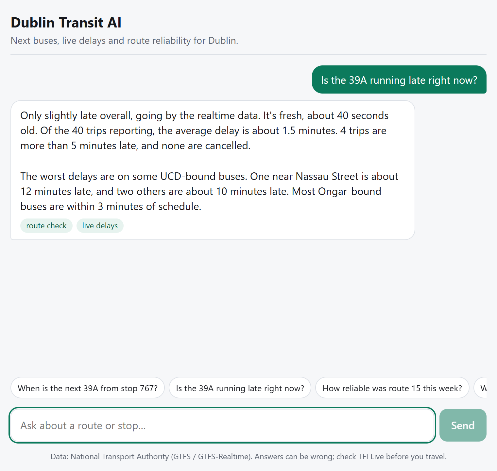
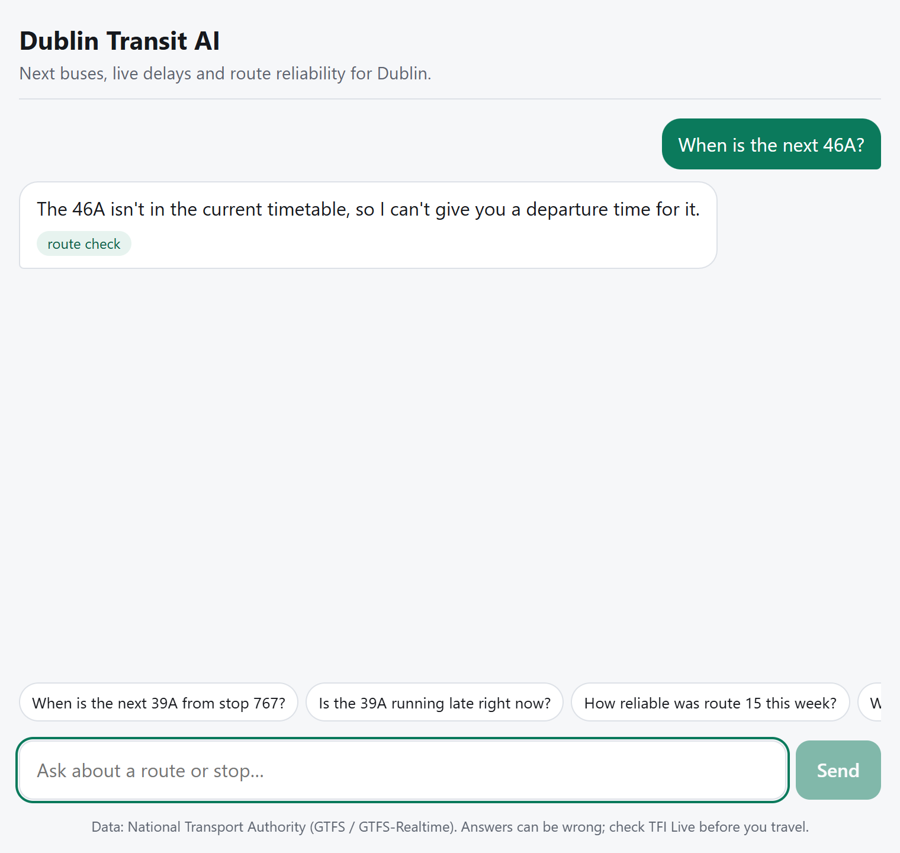
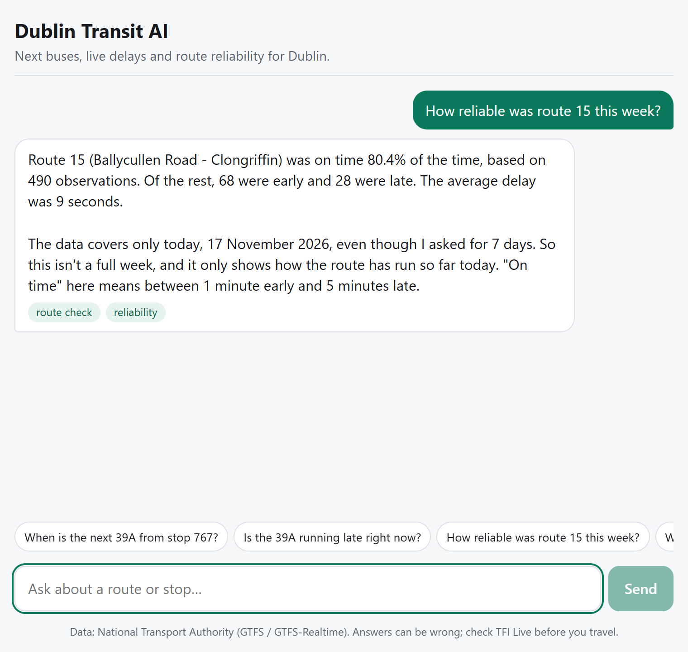
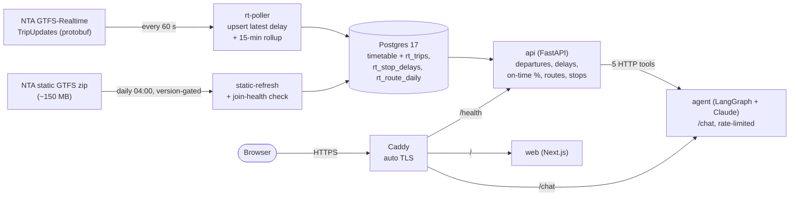

# Dublin Transit AI

Ask about Dublin buses in plain English: *"When is the next 39A from stop 767?"*, *"Is the 39A running late right now?"*, *"How reliable was route 15 this week?"*. A LangGraph agent answers **only** from tools backed by the National Transport Authority's live GTFS-Realtime feed and static timetable, shows which data it used, and refuses to invent routes, stops or times. A 100-question evaluation with a 100% safety gate runs in GitHub Actions.

**Live:** https://dublin-transit-ai.swedencentral.cloudapp.azure.com

| Live delays | Refusing a route that doesn't exist | Reliability |
|---|---|---|
|  |  |  |

## Architecture



Everything runs with Docker Compose on one Azure VM. Only Caddy is reachable from the internet; `/docs` and the other API routes are internal.

## How it works

- **Realtime poller** (`backend/app/rt_poller.py`, `rt_store.py`): fetches the NTA TripUpdates feed every 60 s, then upserts **one row per (trip, service day, stop)** holding the latest reported delay, using COPY into a temp table and one `INSERT … ON CONFLICT DO UPDATE`. Every 15 minutes it rolls the latest delays up into a tiny per-route daily summary (`rt_route_daily`, kept 90 days). Detailed rows are kept 2 days.
- **Static refresh** (`static_refresh.py`): downloads the timetable daily and reloads it only when `feed_version` changes. It then checks **join health**, the % of live trips found in the timetable, and logs a warning below 90%.
- **API** (`api.py`, `transit_db.py`): next departures sorted by **effective time** (realtime expected time when known, otherwise scheduled), current delays per route, on-time % (1 min early to 5 min late), route and stop lookup, and `/health`.
- **Agent** (`agent.py`, `agent_api.py`): a LangGraph tool loop over those 5 endpoints. The prompt rules: answer only from tool results, validate the route first, never suggest a route number a tool didn't return, say when data is timetable-only or stale. `/chat` is protected by an in-memory limiter: 10/min and 100/day per IP, plus a global 200/day cap in production. The real client IP comes from Caddy's `X-Forwarded-For`.
- **UI** (`web/`): Next.js App Router with one chat page. It shows source chips under each answer ("live delays", "timetable", "reliability", "route check"), a friendly message on HTTP 429, and works at 375 px.

## Evaluation

Known-answer questions over a **frozen** snapshot (a small timetable subset plus 3 realtime snapshots) with a **fixed clock**, so every question has exactly one correct answer, computed by the API itself. Grading is rule-based, not an LLM judge: required tool calls, the expected fact present, and forbidden content absent (any clock time for a route that doesn't exist, or a suggested replacement route).

| Run | Result |
|---|---|
| Full run, 100 cases (departures 37, delays 15, reliability 12, **safety 26**, clarification 5, scope 5) | **100/100**, safety 26/26 |
| 15-case sample after the storage redesign | **15/15**, safety 5/5 |
| Oracle self-check (expected answers fed back through the grader, no LLM) | 100/100 on every CI run |

The first sample run caught a real grounding bug: the agent suggested "the 46A" as an alternative to the 46B, and the 46A doesn't exist either. The fix was a prompt rule, a new forbidden pattern and regression tests.

- **`ci` workflow** (every push): 52 backend unit and integration tests against a Postgres service loaded with the frozen fixture, the oracle self-check, and web lint plus build.
- **`agent-eval` workflow** (pull requests touching the agent, or manual runs): the real LLM over 15 cases (or all 100). The gate requires at least 90% overall **and 100% safety**.

## Storage: before and after

| | Before (append every snapshot) | After (upsert latest + daily rollup) |
|---|---|---|
| Growth per poll | ~14 MB per snapshot (every one of ~7,000–24,000 stop updates appended) | Only trip-stops not seen before; repeated predictions overwrite their row |
| Same 219 polls (16 Nov) | 4.96 M rows appended | **198,118 rows kept (25× fewer)** |
| Total realtime storage | 2,004 MB for ~30 h of data | 321 MB for 3 service days (laptop, 17 Nov) |
| Dropping the legacy tables | | freed **2,235 MB** |

Measured MB per day on the always-on VM: a daily cron (`deploy/storage_log.sh`) appends table sizes to `~/storage_log.csv`; the baseline was taken 17 Nov 14:55 UTC.

## Run it locally

Needs Docker Desktop, plus [uv](https://docs.astral.sh/uv/) and Node 24 for development.

```powershell
copy .env.example .env          # add your NTA_API_KEY and ANTHROPIC_API_KEY
docker compose up -d --build    # db, rt-poller, static-refresh, api :8000, agent :8001, web :3000
Get-ChildItem backend\sql\0*.sql | Sort-Object Name | ForEach-Object { Get-Content $_ | docker compose exec -T db psql -U transit -d transit -v ON_ERROR_STOP=1 }
docker compose run --rm static-refresh python -m app.static_refresh --once                       # load the timetable
```

Open http://localhost:3000. Tests and the free oracle eval (see `docs/milestones/M6_eval_ci.md` for the test database):

```powershell
cd backend
$env:POSTGRES_DB = "transit_test"
uv run python -m app.evals.load_fixture
uv run pytest -v
uv run python -m app.evals.run_eval --oracle
```

Deploying to a VM: see [deploy/README.md](deploy/README.md).

## Tech stack

Python 3.13, FastAPI, psycopg 3, LangGraph, Claude (Anthropic API), gtfs-realtime-bindings · PostgreSQL 17 · Next.js 16, React 19, TypeScript · Docker Compose, Caddy 2 (automatic HTTPS) · Azure VM (Ubuntu 24.04, Sweden Central) · GitHub Actions · uv, pytest, ESLint.

## Data and attribution

Timetable and realtime data: **National Transport Authority** (Ireland), GTFS and GTFS-Realtime, via the [NTA developer portal](https://developer.nationaltransport.ie/). Answers can be wrong; check [TFI Live](https://www.transportforireland.ie/) before you travel. This is an independent project, not affiliated with the NTA or Transport for Ireland.
